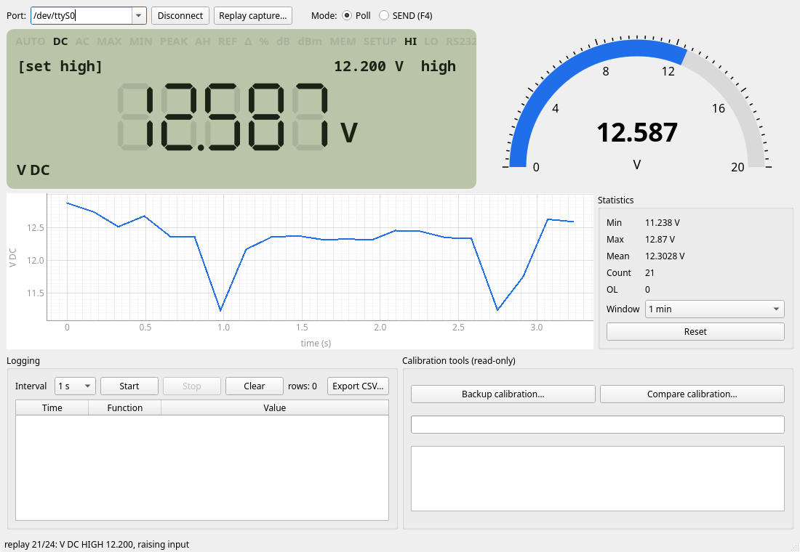
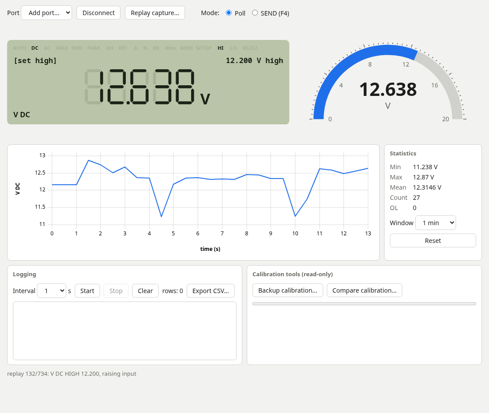

# ISO-TECH IDM207 virtual meter and protocol notes

Read an **ISO-TECH IDM207** multimeter (the same meter as the **APPA 207**, sold under the ISO-TECH name) over its RS232 port without the original
2006 Windows program: a virtual LCD, live chart and statistics, CSV datalogging, SEND-key capture and
read-only calibration backup/compare. The serial protocol was reverse engineered and verified on a real meter.

Two interchangeable apps share one protocol spec and one set of test vectors (`apps/spec/`):

| | Desktop app (`apps/py-meter`) | Web app (`apps/web-meter`) |
|---|---|---|
| Stack | Python, PyQt6, pyqtgraph, pyserial | TypeScript, Vite, uPlot, Web Serial |
| Platforms | Windows, Linux, macOS | any OS with Chrome / Edge / Opera / Brave |
| Install | download from Releases, unzip, run | open the [hosted copy](https://alweekes.github.io/idm207-meter/) (nothing to install) |

*Desktop app (PyQt6), replaying a capture of a rising DC voltage with a HIGH limit set.*

*Web app (TypeScript + Web Serial), same capture.*

See [`apps/COMPARISON.md`](apps/COMPARISON.md) for how they compare.

## Install

Download from the [Releases](../../releases) page:

- **Desktop:** `idm207-meter-windows-x86_64.zip`, `idm207-meter-macos-arm64.zip`, `idm207-meter-macos-x86_64.zip`,
  `idm207-meter-linux-x86_64.tar.gz`. Unpack and run `idm207-meter`. The builds are unsigned: on macOS
  right-click → Open the first time, on Windows choose "More info → Run anyway" in SmartScreen.
- **Web:** open https://alweekes.github.io/idm207-meter/ in Chrome, Edge, Opera or Brave and click Connect. It is
  rebuilt from `main` whenever the web app changes. To run offline, download `idm207-web-meter.zip`; Web Serial needs
  a secure context, so serve it from localhost:
  `cd idm207-web-meter && python3 -m http.server 8000`, then open http://localhost:8000 in Chrome.

Or run from source (see `apps/py-meter/README.md` and `apps/web-meter/README.md`).

**Serial port access:** Linux users need to be in the `uucp` (Arch) or `dialout` (Debian/Ubuntu) group.
Windows shows the meter as `COMn`. The meter's cable is 9600 baud, 8N1 (no setup needed).
Both apps have a replay mode (`--replay reverse-engineering/capture.log`, or *Replay capture…* in the web app)
so you can try them without a meter.

## Protocol in brief

Full write-up: [`reverse-engineering/README.md`](reverse-engineering/README.md). Raw frames from every
rotary position and menu: [`reverse-engineering/capture.log`](reverse-engineering/capture.log).
The IDM207 is the ISO-TECH-badged APPA 207. It uses the same protocol as the APPA 300 series (the handheld
APPA 303 and relatives share the WinDMM software), and the frame layout agrees with APPA's 300-series addendum, summarised in
[`WinDMM300-RS232-Protocol-Summary.md`](WinDMM300-RS232-Protocol-Summary.md).

- 9600 baud, 8N1. PC sends `55 55 00 00 AA`; the meter answers with a 59-byte frame starting `55 55 00 36`.
  Checksum = sum of the first 58 bytes mod 256. Sync on the header; the first read after opening may carry a junk byte.
- Bytes 4–26 hold model, serial and firmware as ASCII; byte 27 is the rotary position, 28 the sub-mode (DC/AC/…),
  29 the last key press (momentary), 30 the range. Main, left and right displays are 6 bytes each:
  value (little-endian, **sign-magnitude**), decimal point, unit, sub-code.
- Overload has no flag: it is full scale + 1 count (e.g. 40001), with an ambiguity in 4000-count mode.
- Menu screens (STORE/RECALL, MAX/MIN, PEAK HOLD, REF/Δ/%, limits, dBm) reuse the left/right displays with
  distinct sub-codes. HI/LO, PH and DIGIT state are **not** in the frame; the apps infer what they can.
- Extra PC → meter commands `01`–`0E` read single fields; `0E <idx>` reads the 256 calibration constants.

### ⚠ Do not send commands ≥ 0x80

Commands from `0x80` up are writes. While probing, `0x80` overwrote this meter's model name (later restored
from a backup). Both apps can only build the safe commands `00` and `0E` (enforced in code and tests), and
`reverse-engineering/scripts/idm207.py` is read-only apart from that. Back up calibration data
(`--backup-cal`) before experimenting with anything else.

## Repository layout

- `apps/spec/` – UI spec, `make_vectors.py` and `test-vectors.json` (454 captured frames with expected decodes)
- `apps/py-meter/`, `apps/web-meter/` – the two apps (`pytest` / `npm test` run the shared vectors)
- `reverse-engineering/` – protocol notes, command-line reader `scripts/idm207.py`, extraction tools for LabVIEW
  resources, `capture.log`
- `.github/workflows/release.yml` – tests and builds the release artifacts for all platforms on a `v*` tag

The original vendor software, manuals, and files extracted from them are not included in this repository,
so some paths mentioned in the reverse-engineering notes (the WinDMM install, CalWin300, calibration backups)
only exist on the author's machine.

## Disclaimer

Independent project, not affiliated with ISO-TECH, APPA or IDEAL Industries. Use at your own risk, especially
anything beyond the read-only features.

## License

MIT, see `LICENSE`.
